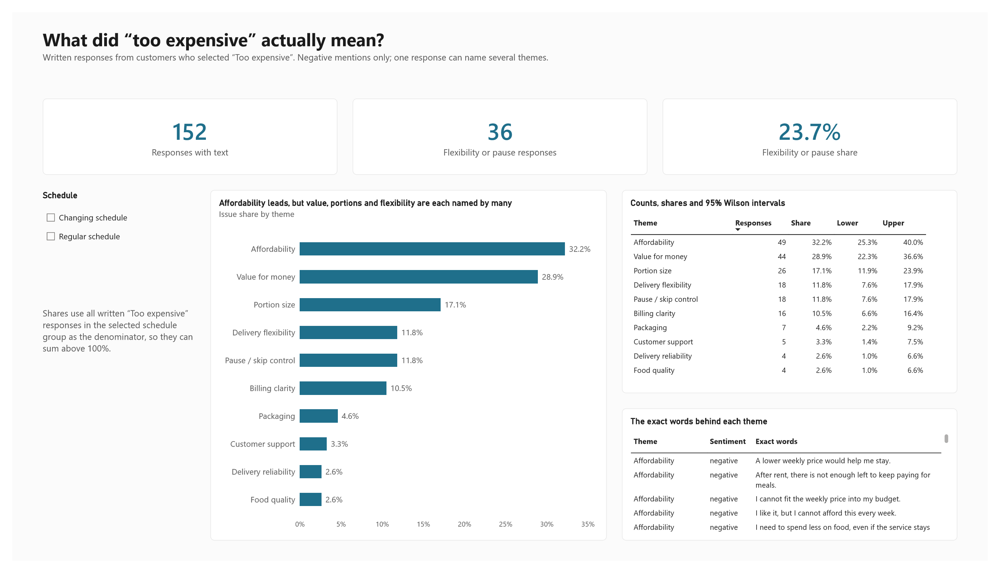

# Customer voice in Power BI

The same question as the case, answered in a three-page Power BI report: when customers select “Too expensive”, what do their words say?

[Report file](customer-voice.pbix) · [PDF export](customer-voice-report.pdf) · [Measures](measures.dax) · [Expected values](expected-values.csv)



## Pages

| Page | Question | What it shows |
|---|---|---|
| [Who answered](screenshots/page-1.png) | Who is in the data? | 1,200 customers, 500 invited, 303 responded. Response rate is 69.7% for changing schedules and 54.5% for regular ones. |
| [What too expensive meant](screenshots/page-2.png) | What did the 152 written “Too expensive” responses name? | Affordability 49, value for money 44, portion size 26; 36 name delivery flexibility or pause control. Shares carry 95% Wilson intervals, and a schedule slicer changes the denominator with the selection. |
| [Orders at customer grain](screenshots/page-3.png) | How do weekly orders relate to survey responses? | 14,400 customer weeks, 1,028 late. Responder measures count orders for the customers behind the selected responses without repeating a response across weekly rows. |

## Model

Six tables: `customers`, `invitations`, `responses`, `assignments`, `orders` and `themes`. Five single-direction, many-to-one relationships:

| Many side | One side |
|---|---|
| invitations[customer_id] | customers[customer_id] |
| responses[customer_id] | customers[customer_id] |
| orders[customer_id] | customers[customer_id] |
| assignments[response_id] | responses[response_id] |
| assignments[theme_id] | themes[theme_id] |

Two design decisions matter for the numbers:

- **The theme filter reaches `assignments` only.** A theme share is the distinct responses naming that theme divided by all written responses in the selection, so the denominator must ignore the theme.
- **A response filter does not reach `orders`.** `Responder customer weeks` and `Responder late weeks` pass the customer list across explicitly with `TREATAS`, so weekly rows are never multiplied through a survey join.

## Measures and checks

[measures.dax](measures.dax) holds the 18 measures and four check queries. The Wilson interval measures use the same formula as [analysis.R](../analysis.R).

[build_checks.py](build_checks.py) computes 85 expected values from the CSV files with the Python standard library, independently of the DAX, and writes [expected-values.csv](expected-values.csv). The model was queried directly and returns the same counts, shares and interval bounds, including 16 of 66 against 2 of 86 for delivery flexibility by schedule.

```sh
python powerbi/build_checks.py
```

## Open or rebuild

- Open `customer-voice.pbix` in Power BI Desktop to explore the report. It carries its data.
- `customer-voice.pbip`, `customer-voice.SemanticModel/` and `customer-voice.Report/` are the same report as Power BI project files: the model in TMDL and the pages in the enhanced report format, readable as text.
- To refresh, copy this case's `data/*.csv` and [themes.csv](themes.csv) to `C:\Data\customer-voice\`, or change the file paths in the six queries.

## Boundaries

The data are the case's synthetic meal-subscription scenario; see [data and research design](../data/README.md). The report describes that dataset and makes no claim about a real business. AI assisted with the project files and measures; every published value is tied to the independent checks above.
